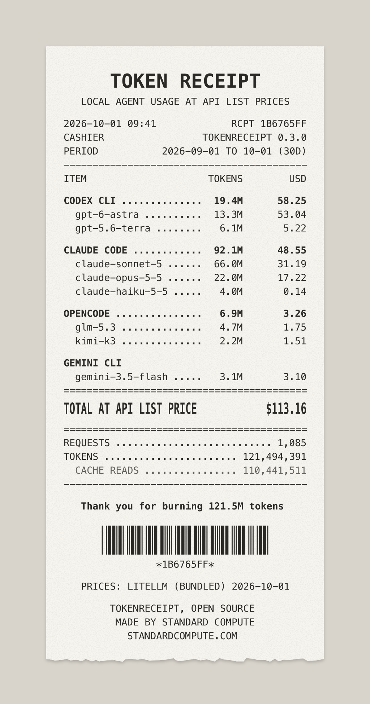
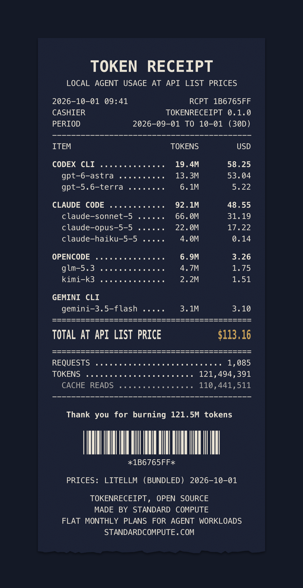

# tokenreceipt

A till receipt for your AI coding agents. tokenreceipt reads the usage logs your agents
already keep on your machine, adds up the tokens per agent and per model, and prices them
at public API list prices.

```sh
npx github:henrikdukefoss/tokenreceipt
```

Node 18 or newer. No dependencies, no account, no upload.

<p>
  
  
</p>

The receipts above are rendered from the synthetic fixtures in `test/fixtures/sample-home`,
not from anyone's real usage.

## Usage

```sh
npx github:henrikdukefoss/tokenreceipt                     # last 30 days
npx github:henrikdukefoss/tokenreceipt --since 7d          # 7d, 30d, 90d, any <n>d, all, or YYYY-MM-DD
npx github:henrikdukefoss/tokenreceipt --svg receipt.svg   # shareable card
npx github:henrikdukefoss/tokenreceipt --png receipt.png   # same card as PNG, for X and Reddit
npx github:henrikdukefoss/tokenreceipt --theme dark --png receipt.png
npx github:henrikdukefoss/tokenreceipt --json              # data only
npx github:henrikdukefoss/tokenreceipt --project           # only this repo (or --project <path>)
npx github:henrikdukefoss/tokenreceipt --badge             # "built with N tokens" README badge for this repo
```

| Option | Meaning |
| --- | --- |
| `--since <period>` | `7d`, `30d` (default), `90d`, `<n>d`, `all`, or a start date `YYYY-MM-DD` |
| `--svg <file>` | write the receipt card as SVG |
| `--png <file>` | write the card as a 2x PNG, using `rsvg-convert`, `resvg` or a local Chrome, Chromium or Edge |
| `--theme <name>` | card theme: `paper` (default) or `dark` |
| `--json` | print totals per agent and model as JSON |
| `--badge` | print a "built with N tokens" Markdown badge instead of the receipt. Inside a git repo it counts only that repo (`--project .`) |
| `--badge-cost` | same badge, with the total at API list price added |
| `--project [path]` | only sessions that ran inside this folder. Without a path: the current folder. Inside a git repo the folder is widened to the repo root |
| `--all-projects` | count every project, also for `--badge` inside a git repo |
| `--agent <ids>` | only some agents, comma separated, for example `claude-code,codex` |
| `--offline` | use the bundled price table and make no network request |
| `--no-color` | plain terminal output |

X and Reddit do not accept SVG uploads, so use `--png` for posting. If no converter is
installed, open the SVG in a browser and take a screenshot.

## Terminal output

```text
        T O K E N   R E C E I P T
   LOCAL AGENT USAGE AT API LIST PRICES

2026-10-01 09:41             RCPT 1B6765FF
CASHIER                 TOKENRECEIPT 0.3.0
PERIOD           2026-09-01 TO 10-01 (30D)
------------------------------------------
ITEM                     TOKENS        USD

CODEX CLI ..............  19.4M      58.25
  gpt-6-astra ..........  13.3M      53.04
  gpt-5.6-terra ........   6.1M       5.22

CLAUDE CODE ............  92.1M      48.55
  claude-sonnet-5 ......  66.0M      31.19
  claude-opus-5-5 ......  22.0M      17.22
  claude-haiku-5-5 .....   4.0M       0.14

OPENCODE ...............   6.9M       3.26
  glm-5.3 ..............   4.7M       1.75
  kimi-k3 ..............   2.2M       1.51

GEMINI CLI
  gemini-3.5-flash .....   3.1M       3.10
==========================================
TOTAL AT API LIST PRICE            $113.16
==========================================
REQUESTS ........................... 1,085
TOKENS ....................... 121,494,391
  CACHE READS ................ 110,441,511
------------------------------------------

   Thank you for burning 121.5M tokens

                *1B6765FF*

   PRICES: LITELLM (BUNDLED) 2026-10-01

        TOKENRECEIPT, OPEN SOURCE
         MADE BY STANDARD COMPUTE
  FLAT MONTHLY PLANS FOR AGENT WORKLOADS
           STANDARDCOMPUTE.COM
```

The list of agents found and not found is printed to stderr, so `--json` output stays clean.

## README badge

Show how many tokens went into a project with a badge in its README. Run this inside the repo:

```sh
npx github:henrikdukefoss/tokenreceipt --since all --badge
```

It prints one line of Markdown to paste:

```markdown
[](https://github.com/henrikdukefoss/tokenreceipt)
```

[](https://github.com/henrikdukefoss/tokenreceipt)

`--badge-cost` adds the total at API list price:

[](https://github.com/henrikdukefoss/tokenreceipt)

The examples are from the synthetic fixtures in `test/fixtures/projects-home` (`--project /work/alpha`)
and `test/fixtures/sample-home` (`--all-projects`).

- Inside a git repo, `--badge` counts only sessions that ran in that repo or a folder below it,
  as if you had passed `--project .`. Outside a repo, or with `--all-projects`, it counts every
  matching log on your machine. The project in use is printed to stderr.
- Agents whose logs do not record a folder (Hermes) are left out of a per-project count, with
  a note on stderr. See [Per-project totals](#per-project-totals).
- The badge uses the same filters as the receipt: `--since` for the period and `--agent` for the agents.
- When some models have no list price, the cost is shown with a `+`, because the real figure is higher.
- It is a static [shields.io](https://shields.io/badges/static-badge) image: the numbers are part of
  the URL. tokenreceipt only prints it. Once it is in your README, shields.io serves the image to
  whoever views it.

## Supported agents

tokenreceipt detects each agent on its own and skips the ones that are not installed.

| Agent | Where it reads | Notes |
| --- | --- | --- |
| Claude Code | `~/.claude/projects/**/*.jsonl`, `~/.config/claude/projects` | Respects `CLAUDE_CONFIG_DIR` (comma separated). Streamed duplicates are counted once per message id and request id. 1-hour cache writes are priced as such. |
| Codex CLI | `~/.codex/sessions/**/*.jsonl` | Respects `CODEX_HOME`. Uses per-response `token_usage_record` lines, or per-turn `token_count` events in older files. |
| OpenCode | `~/.local/share/opencode/opencode.db`, legacy `storage/message/**/*.json` | Respects `XDG_DATA_HOME`. The database needs Node 22.5+ (`node:sqlite`) or the `sqlite3` command. |
| Gemini CLI | `~/.gemini/tmp/*/chats/*.json{,l}` | Respects `GEMINI_CLI_HOME` and `GEMINI_DATA_DIR`. |
| Cline | VS Code `globalStorage/saoudrizwan.claude-dev/tasks`, `~/.cline/data/sessions` | Classic extension and the newer SDK-based extension and CLI. Respects `CLINE_DIR`, `CLINE_DATA_DIR`. |
| Roo Code | VS Code `globalStorage/rooveterinaryinc.roo-cline/tasks` | A custom storage path set in Roo's settings is not detected. |
| Kilo Code | `~/.local/share/kilo/kilo.db`, legacy `globalStorage/kilocode.kilo-code/tasks` | Respects `KILO_DB`. |
| Pi | `~/.pi/agent/sessions/**/*.jsonl` | Respects `PI_CODING_AGENT_DIR`, `PI_CODING_AGENT_SESSION_DIR`. Forked sessions are counted once. |
| Hermes | `~/.hermes/state.db` and profiles | Respects `HERMES_HOME`. Hermes stores per-session totals, so a period boundary splits usage by session, not by request. |

VS Code-family folders are looked up for Code, Code - Insiders, VSCodium, Cursor and Windsurf.

### Per-project totals

`--project [path]` keeps only sessions whose recorded working folder is the project folder or
a folder below it. A path inside a git repo is widened to the repo root. Where each agent
records the folder:

| Agent | Per project | Recorded as |
| --- | --- | --- |
| Claude Code | yes | `cwd` on every log line. Lines without it fall back to the `~/.claude/projects/<folder>` name, which only matches the project root itself |
| Codex CLI | yes | `cwd` in `session_meta` and per turn in `turn_context` |
| OpenCode | yes | `path.cwd` on each assistant message, else the session's `directory` |
| Gemini CLI | yes | `tmp/<id>/.project_root` or `~/.gemini/projects.json`. Older sha256-named folders only match the project root itself |
| Cline | yes | `cwdOnTaskInitialization` in `state/taskHistory.json` or the "Current Working Directory" in the task's environment details; SDK sessions: `cwd` in the session manifest |
| Roo Code | yes | "Current Workspace Directory" in the task's environment details |
| Kilo Code | yes | `kilo.db` like OpenCode; legacy tasks like Roo Code |
| Pi | yes | `cwd` in the session header |
| Hermes | no | `state.db` keeps per-session totals with no working folder, so Hermes is skipped and named on stderr |

Requests with no recorded folder are left out, and their count is printed as a note.

Planned: Amp, Goose, Aider, Continue, Zed, Copilot CLI and OpenClaw. A reader is added once its
log format is confirmed from source code or documentation. Pull requests with a fixture are welcome.

## How the price is worked out

- Prices come from LiteLLM's public [model price list](https://github.com/BerriAI/litellm/blob/main/model_prices_and_context_window.json)
  (MIT licensed). It is fetched at most once a day and cached in `~/.cache/tokenreceipt`.
  `--offline`, or a failed fetch with no cache, uses a snapshot bundled in `src/prices-fallback.json`.
- Each request is priced on its own: uncached input, output (reasoning included), cache reads
  and cache writes each at their own rate, with long-context rates when the request is over
  the vendor's threshold. When a model has no cache price, cached tokens are billed at the
  input price, as LiteLLM does.
- Models routed through a gateway under a non-vendor name, such as `standardcompute`, and models
  missing from the price list are shown as `unpriced` with their token counts. Prices are never guessed.
- List prices are what the same tokens would cost on pay-as-you-go API billing. They are not
  what you paid if you are on a subscription, a discount or free credits.

## Privacy

- Everything runs locally. Logs are read, never copied or uploaded.
- The only network request fetches the public price list from raw.githubusercontent.com.
  `--offline` makes no request at all.
- The receipt shows agent names, model names, token counts and prices. It does not include
  prompts, file paths, project names or your hostname, except the project folder's name when
  you pass `--project`. Check the image before you post it.
- `--badge` only prints a shields.io URL with the token total (and cost, with `--badge-cost`).
  Nothing is sent until you publish it.

## Related guides

Written by Standard Compute, which makes tokenreceipt:

- [The Agent Burn Index](https://standardcompute.com/agent-burn-index): how many tokens AI coding agents use, measured.
- [AI coding agent monthly costs](https://standardcompute.com/ai-coding-agent-monthly-cost): real monthly spend per agent, not pricing pages. Also in: [Español](https://standardcompute.com/costo-agente-de-codificacion-ia) · [Português](https://standardcompute.com/custo-agente-de-codificacao-ia) · [Français](https://standardcompute.com/cout-agent-de-codage-ia) · [日本語](https://standardcompute.com/ai-coding-agent-hiyou) · [한국어](https://standardcompute.com/ai-coding-agent-biyong) · [简体中文](https://standardcompute.com/ai-coding-agent-feiyong) · [Norsk](https://standardcompute.com/kostnad-ai-kodeagent)
- [How to cut your AI agent's API bill](https://standardcompute.com/cut-ai-agent-api-costs): seven tactics, with per-agent pages.
- [Reduce Claude Code token usage](https://standardcompute.com/reduce-claude-code-token-usage): ten levers ranked with real data.
- [tokenreceipt on the web](https://standardcompute.com/tools/token-receipt): what the receipt shows and how to read it.

## Who makes this

tokenreceipt is open source and made by [Standard Compute](https://standardcompute.com), which
sells flat monthly plans for agent workloads. The receipt footer names Standard Compute. The
counting and pricing do not depend on which provider you use.

## Contributing

```sh
git clone https://github.com/henrikdukefoss/tokenreceipt
cd tokenreceipt
npm test                 # node:test, no install step
node bin/tokenreceipt.js --since all   # the card notes "ALL AVAILABLE LOCAL LOGS": only logs still on this machine are counted
```

- Readers live in `src/readers/`. Each one exports `id`, `name` and `load({ sinceMs, untilMs, env })`
  and returns events with `input` (uncached), `output`, `cacheRead` and `cacheWrite` tokens.
- Every reader has a small fixture under `test/fixtures/home` that mirrors the real on-disk format,
  and a test next to it. Never commit real logs.
- `npm run sample` rebuilds the images and terminal sample in `docs/` from
  `test/fixtures/sample-home` (`node scripts/make-sample-fixtures.js` regenerates that data).
- `npm run update-prices` refreshes the bundled price snapshot.
- Keep it dependency free.

## License

MIT
